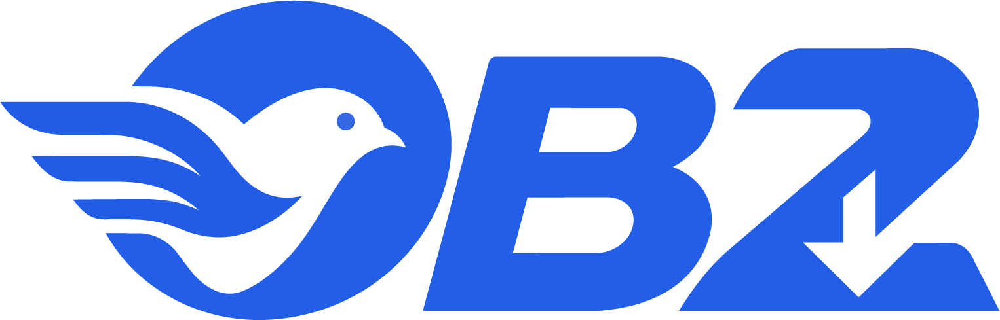

<h1 align="center">
  <picture>
    <source media="(prefers-color-scheme: dark)" srcset="assets/logo/inside_readme_on_github.png" />
    
  </picture>
</h1>

**A download manager for Windows, designed and written from scratch.**

<p>
  
  
  
  
  
  
</p>
<p>
  
  
  
  
  
</p>
<p>
  
  
  
</p>

OB2 splits each download across many connections, resumes after a crash or a reboot, organizes files by type, and runs queues on a schedule. A companion extension for Chrome and Edge sends browser downloads, page links, and videos straight to the app. It ships as one portable folder: no installer, and no .NET install needed.

---

## An original, native application

OB2 is its own product with its own design. It is not a clone, port, or reskin of any other download manager.

- **All code is written for this project.** OB2 has its own segmented download engine, database schema, browser protocol, user interface, and file handling. It contains no code from other download managers.
- **Native Windows software.** The desktop app is C# on .NET 10 with WPF, compiled to a self-contained `OB2.exe`. It is not a web page in a wrapper. It calls Windows features directly: NTFS sparse files, Mark-of-the-Web, DPAPI encryption, named pipes, and browser Native Messaging.
- **Original artwork.** The OB2 logo was designed for this project ([assets/logo](assets/logo)), and the app and extension icons are made from it. No third-party icons, sounds, or images are used.
- **Its own protocol.** The extension, the native host, and the app talk through a small versioned JSON protocol, specified in [docs/protocol.md](docs/protocol.md).
- **Decisions on record.** More than 70 design decisions, each with its reason, are kept in [docs/decisions.md](docs/decisions.md).

OB2 uses well-known open-source libraries for plumbing; see [Tech stack](#tech-stack). For video sites only, it can download the open-source tools yt-dlp, ffmpeg, and Deno on first use, after asking you and checking their checksums.

---

## Features

### Downloading
- **1–32 connections per file**, with a per-server connection cap. If a server refuses range requests, OB2 falls back to one connection.
- **Resume anywhere.** Progress is checkpointed, so pausing, closing the app, a crash, or a reboot doesn't lose finished parts.
- **Automatic retries** with exponential backoff and jitter. `Retry-After` is honoured.
- **Expired links are refreshed.** If a signed URL stops working mid-download, OB2 asks the original link for a fresh address and continues.
- **Speed limits**, global or per download, enforced by a token bucket.
- **Integrity checks.** Optional MD5 or SHA-256 verification, disk-space checks before starting, and a size check at the end.

### Organizing
- **Categories** (Documents, Music, Video, Programs, Compressed, or your own) each save to their own folder.
- **Queues** have concurrency limits and weekday schedules. When a queue finishes, OB2 can sleep, shut down, or run a command.
- **Search, filters, and history**, all stored in a local SQLite database.

### Browser integration (Chrome and Edge)
- **Capture.** Downloads you start in the browser are handed to OB2 with their cookies and referrer. Rules decide what to capture: file types, minimum size, and excluded sites.
- **Fail-open.** If OB2 can't be reached, the browser downloads the file normally. Hold **Shift** while clicking to skip OB2 for one download.
- **"Download with OB2"** appears on every link's right-click menu.
- **Video button.** A button appears over playing videos that have a direct file.
- **Page link finder.** The popup lists every downloadable file on the current page, including addresses hidden in scripts.
- **Video sites** such as YouTube open a quality and audio-track chooser, and the download then behaves like any other row (pause, resume, progress).

### Safe by default
- File names are cleaned up: no path traversal, reserved names, or right-to-left tricks that disguise an extension.
- Downloaded files carry **Mark-of-the-Web**, so Windows SmartScreen and Office treat them as coming from the internet.
- **Cookies and URL query strings are never logged.** Remembering website sign-ins is opt-in and encrypted with DPAPI for the current Windows user.
- Risky file types (`.exe`, `.ps1`, …) ask for confirmation before they open.

### Desktop experience
- A three-pane window (categories, download list, details) shows progress for each connection.
- Tray icon, Windows notifications, drag-and-drop links, and optional start with Windows.
- A headless command line for scripts: `OB2.exe get <url>`.

---

## How it works

```
 Chrome / Edge                        Windows desktop
┌──────────────────┐  Native      ┌──────────────┐  named pipe  ┌──────────────────────────────┐
│ OB2 extension    │  Messaging   │  host.exe    │  (per user)  │  OB2.exe (WPF)               │
│ MV3, TypeScript  │ ───────────► │  short-lived │ ───────────► │  ├─ Download engine          │
│ capture · popup  │ ◄─────────── │  relay       │ ◄─────────── │  ├─ Queues and scheduler     │
│ video button     │   JSON v1    └──────────────┘   JSON v1    │  ├─ SQLite (WAL) + settings  │
└──────────────────┘                                            │  └─ Tray, notifications      │
                                                                └──────────────────────────────┘
```

- **Engine** ([src/OB2.Core](src/OB2.Core)): first probes the server for size, range support, and file name. Then it splits the file into segments and streams each one into a sparse `.pgpart` file through `HttpClient`, checkpointing positions to the database. When every segment is done, it verifies the file and renames it into place.
- **Native host** ([src/OB2.Host](src/OB2.Host)): a small, trimmed, ReadyToRun executable that the browser starts for each message. It forwards the message to the running app over a named pipe, and starts the app if it isn't running.
- **Storage** ([src/OB2.Storage](src/OB2.Storage)): a SQLite database with versioned SQL migrations, JSON settings written atomically, rolling Serilog logs, and the portable/per-user path rules.

---

## Getting started

### Requirements
| To | You need |
|----|----------|
| Run a release | Windows 10 1809+ or Windows 11, 64-bit. Nothing else. |
| Build the app | [.NET 10 SDK](https://dotnet.microsoft.com/download/dotnet/10.0) (`winget install Microsoft.DotNet.SDK.10`) |
| Build the extension | Node.js 22 and npm |

### Build, test, run
```powershell
dotnet build OB2.sln -c Release
dotnet test  OB2.sln -c Release
dotnet run --project src/OB2.App -c Release
```

### Build the extension
```powershell
cd extension
npm ci
npm run typecheck
npm test
npm run build        # output: extension/dist
```

### Make a portable release
```powershell
powershell -ExecutionPolicy Bypass -File build/publish.ps1 -Version 1.0.0 -IncludeHost
```
This produces `publish/OB2-portable/`, containing `OB2.exe`, `host.exe`, `chrome-extension/`, `portable.flag`, and `README.txt`. It also writes `publish/OB2-portable.zip` and `publish/SHA256SUMS.txt`. Leave out `-IncludeHost` to build the app alone.

### Connect the browser
1. In OB2, open **Options › Browser** and click **Register**. One registration covers both Chrome and Edge.
2. Open `chrome://extensions` (or `edge://extensions`), turn on **Developer mode**, click **Load unpacked**, and choose the `chrome-extension` folder (or `extension/dist` from a source build).

---

## Usage

| Action | How |
|--------|-----|
| Add a download | **Ctrl+N**, paste a link, drag a link onto the window, or `OB2.exe "https://…"` |
| Pause or resume the selected download | **Space** |
| Open the finished file | **Enter** |
| Delete selected downloads | **Del** |
| Stop all downloads | **Ctrl+Shift+P** |
| Search the list | **Ctrl+F** |

### Command line
```text
OB2.exe get <url> [--out <dir>] [--name <file>] [--connections <1-32>]
                  [--sha256 <hex> | --md5 <hex>] [--data <dir>]
```
To resume an interrupted download, run the same command again. Exit codes: `0` saved, `1` failed, `2` checksum mismatch, `3` paused, `64` usage error.

### Where data lives
| Mode | Location |
|------|----------|
| Portable (`portable.flag` next to `OB2.exe`) | The OB2 folder itself |
| Per-user (no flag, or the folder is read-only) | `%APPDATA%\OB2` |

That folder holds `settings.json`, `data\ob2.db`, `data\logs\`, and, if you use video sites, `tools\`.

---

## Tech stack

| Part | Technology |
|------|------------|
| Desktop app | C# 14, .NET 10 (LTS), WPF, CommunityToolkit.Mvvm, H.NotifyIcon |
| Download engine | `HttpClient` / `SocketsHttpHandler`, token-bucket rate limiting, NTFS sparse files |
| Storage | SQLite (Microsoft.Data.Sqlite, WAL mode), versioned SQL migrations, JSON settings |
| Logging | Serilog with rolling files; secrets are redacted |
| Browser bridge | Native Messaging host (`host.exe`) ↔ app over a per-user named pipe; source-generated JSON |
| Browser extension | Manifest V3 (one build for Chrome and Edge), TypeScript 5, esbuild |
| Tests | xUnit, FluentAssertions, an in-process Kestrel HTTP server; Jest and jsdom for the extension |
| Packaging | Single-file, self-contained publish driven by PowerShell |

The build is strict: nullable reference types, `TreatWarningsAsErrors`, the `latest-recommended` analyzers, and NuGet versions pinned centrally in [Directory.Packages.props](Directory.Packages.props).

---

## Project layout

```
src/
  OB2.App/        WPF desktop app: views, view models, tray, browser bridge, CLI
  OB2.Core/       Engine, HTTP, files, integrity, queues and scheduler, media (yt-dlp)
  OB2.Storage/    SQLite repositories, migrations, settings, logging, app paths
  OB2.Shared/     Wire protocol, message framing, named pipes, host registration
  OB2.Host/       Native Messaging host (host.exe)
extension/        Chrome/Edge MV3 extension (src/, tests/, build.mjs)
assets/logo/      OB2 logo artwork: app icon, in-app wordmark, README header
tests/
  OB2.Core.Tests/         Unit tests for the engine and core logic
  OB2.Storage.Tests/      Database, settings, and path tests
  OB2.Integration.Tests/  End-to-end downloads, IPC, CLI, and registry tests
build/            publish.ps1, the release README, and clean-machine test files
docs/             Protocol, design decisions, backlog, and release reports
```

### Testing notes
- Integration tests download from a local Kestrel server that can simulate missing range support, throttling, stalls, dropped connections, failures, and connection limits. Video-site tests use a fake yt-dlp. No test needs the internet.
- Registry tests write only under `HKCU\Software\OB2.Tests\<guid>` and remove it afterwards.
- Large benchmark tests are opt-in: set `OB2_RUN_LARGE=1`.

---

## Documentation

| Document | Contents |
|----------|----------|
| [docs/protocol.md](docs/protocol.md) | Extension ↔ host ↔ app message protocol (v1) |
| [docs/decisions.md](docs/decisions.md) | Design decisions and their reasons |
| [docs/backlog.md](docs/backlog.md) | Known gaps and planned work |
| [OB2_PRD.md](OB2_PRD.md) | The original requirements and the phased build plan |
| `docs/phase-*-report.md`, [docs/v1.0-report.md](docs/v1.0-report.md) | What each milestone delivered, with test and performance results |
